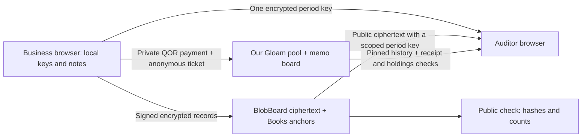

# Quaestor

Private business payments with sealed books and period-scoped audits on QoreChain testnet.

**Keep your books private for decades, and open them to your auditor one quarter at a time.**

Quaestor is a Vite/React web app built for Encrypted Apps. Our deployment of Gloam's open-source pool moves native QOR privately; QoreSeal protects tickets and period grants, and ML-DSA-87 binds the books. The demonstrated periods are daily demo-scale periods; Quarterly is the default. The tagline describes the confidentiality goal, not a guarantee about future cryptanalysis. [Proven scope and limits](CLAIMS.md).

## Try it in three steps

1. Open [the deployed app](https://use-quaestor.vercel.app) and follow [JUDGES.md](JUDGES.md), starting with Public check for the current **Northwind Studio (demo)** book. Its names and purposes are fictional.
2. Choose **Try the demo auditor**. The public, encrypted testnet-only backup and published passphrase load automatically. A/B show five **Matches a real payment** results and two **Holdings cover the books** results. C says **Not shared with you**. Technical codes remain in tooltips; manual backup upload remains available.
3. Open [Attack lab](https://use-quaestor.vercel.app/attack-lab) and its evidence links: modified ciphertext, wrong receipt context, short holdings and a duplicate booking. The lab is read-only. See [M7b evidence](evidence/m7b-browser.json), [fresh auditor](evidence/m7b-fresh-auditors.json) and [unmasked screenshots](evidence/m7b-screens/).

To make a payment yourself, follow [the new-user path](JUDGES.md#try-it-yourself): create account → encrypted backup → manual faucet → **Activate quantum-safe account** → deposit → pay the demo supplier. The transaction window opens automatically with one confirmation. The uninterrupted M10 run measured activation ≈ 1 minute and ≈ 0.32 QOR; whole-flow fees ≈ 0.82 QOR, excluding deposit principal. [M10 attempt report](evidence/m10-signup-attempts/m10-1795594340224-d0023e20cd51bf67/report.json) and [receipt/fee rereads](evidence/m10-signup-cost.json) retain exact values. [Earlier M9 evidence](evidence/m9-fresh-signup.json) preserves the resumed-account flow and failed first attempt; [M9 cost evidence](evidence/m9-activation-cost.json) remains available. Future costs and timings can differ.

The first Northwind run is retained as **superseded: canary content** in [M7 evidence](evidence/m7-browser-initial.json). Privacy canaries now run on **Privacy test (demo)** with [separate evidence](evidence/m8-privacy-browser.json) and masked screenshots. The new fictional judge images have a [visible-text secret scan](evidence/m7b-image-secret-scan.json).

## How it works



The browser encrypts entries under random period keys and signs them with QoreSign. Grants seal a period key to registry-verified recipients using anonymous ML-KEM-1024 + X25519 envelopes. The auditor decrypts locally, verifies anchors and signatures, then checks receipts against rebuilt pool root history. Close-time holdings prove a lower bound against the declared books. Later opening balances are **“opening balance as declared and signed by the business”**; correctness of that declaration is not established. [C1–C6, M7b](CLAIMS.md).

## Encrypted Apps requirements, with evidence

| Requirement | What we do | Code path | Exact test name | On-chain / recorded evidence |
|---|---|---|---|---|
| ML-KEM-1024 | QoreSeal anonymous hybrid tickets; no classical fallback | [ticket.ts](packages/chain/src/tickets/ticket.ts) | T-TICKET seals a real two-recipient hybrid envelope within 8192 bytes and opens for both recipients | [Anonymous ticket and recipient refusal](evidence/m2b-ticket-anonymous.json) |
| Registered recipient keys | Check signed cards against KEM and possession-proven ML-DSA registries at a pinned block | [cardCodec.ts](packages/chain/src/tickets/cardCodec.ts), [kemRegistry.ts](packages/chain/src/tickets/kemRegistry.ts) | T-CARD refuses another signing identity, stale KEM registration and unproven possession | [Registry transactions and verified cards](evidence/m2-ticket.json) |
| ML-DSA key binding | QoreSign signatures bind encrypted records; Books checks owner key status and close signature | [signing.ts](packages/core/src/signing.ts), [Books.sol](contracts/src/Books.sol) | T-BIND edited ciphertext fails the anchor SHA3 and signature even if its stated digest is replaced | [Live precompile acceptance/bit-flip refusal](evidence/m3-precompiles.json), [contract close](evidence/m3-books.json) |
| Client-side encryption and decryption | Browser-only vault/journal, local seal/open/proving, fresh-browser audit; intercept requests and responses | [runtime.ts](apps/web/src/business/runtime.ts), [chainAudit.ts](packages/chain/src/chainAudit.ts) | T-NOPLAIN-WEB daily A/B closed, C private, complete backup and B-only grant | [Separate canary journey](evidence/m8-privacy-browser.json), [M7b fresh browser](evidence/m7b-fresh-auditors.json) |

These results cover the exercised native-QOR flows and known secret encodings, not every browser, extension or encoding. [CLAIMS C5](CLAIMS.md) states the exclusions.

## QoreChain features used

All hashes below are real application transactions. Libraries and templates do not have independent on-chain identities; the hashes show the operation that used them. `pqcKeyStatus`/`pqcVerify` also have pinned read-call evidence, because an eth_call has no transaction hash. [Receipt recheck and provenance](evidence/m8-kits.json).

| Feature / kit | Use and evidence | Transaction hash |
|---|---|---|
| KEM registry | Business ML-KEM registration, [M2](evidence/m2-ticket.json) | `8A8AFDBFD76F673141B8DEB7FDE937CE1B007A42E9F6A470BCEC137510B3AA85` |
| ML-DSA registry with possession proof | Auditor registration; [M2](evidence/m2-ticket.json), [key checks](evidence/m3-precompiles.json) | `A1D0F3DED37ED9D25B40D4483CBB5A0020AF4FE6B1E699B725522492C9E51230` |
| Hybrid native transactions | ML-DSA + classical authorization of a window, [M2b](evidence/m2b-ticket-anonymous.json) | `3A8964FF902A8F5F586868C9FC05FE850EA755658146CD926071CC6E8A1B8B99` |
| EVM windows | Window before EVM nonce/sign/broadcast, [window.ts](packages/chain/src/window.ts) | `3A8964FF902A8F5F586868C9FC05FE850EA755658146CD926071CC6E8A1B8B99` |
| pqcKeyStatus, 0x0A02 | Books requires possessionProven; [pinned read](evidence/m3-precompiles.json), [close](evidence/m3-books.json) | `0x572e58fb84757b0207ab9f4de71a57a80a221ece7cd0cbfc2f84a8b05a2f814f` |
| pqcVerify, 0x0A01 | Raw ML-DSA-87 close verified by Books; flipped signature refused in [spike](evidence/m3-precompiles.json) | `0x572e58fb84757b0207ab9f4de71a57a80a221ece7cd0cbfc2f84a8b05a2f814f` |
| QoreSeal 0.1.0 | Anonymous hybrid memo envelope, [M2b](evidence/m2b-ticket-anonymous.json) | `0x4438d004b7adf24786fb7ddc0b61822a85219966745a896044d3f2cfffba5efd` |
| QoreSign 0.2.0 | Signs the sealed close record locally; the associated close tx uses a separate SDK raw ML-DSA signature, [signing.ts](packages/core/src/signing.ts) | `0x572e58fb84757b0207ab9f4de71a57a80a221ece7cd0cbfc2f84a8b05a2f814f` |
| QoreChain SDK / EVM 0.14.0; pqc 0.2.3 through SDK | Native signing, registry and window integration; [dependencies](apps/web/package.json) | `3A8964FF902A8F5F586868C9FC05FE850EA755658146CD926071CC6E8A1B8B99` |
| create-qorechain-dapp 0.14.0 | Foundry window helper scaffold; [provenance](tools/evm-window/package.json), [builder's initial registration record](docs/ai-log/2026-11-20.md). A build-time template, not a runtime dependency | `98235E8AB0B6D450939EC05A60CDCA1A1FB6B7CB386C1D25A9254890B813DD52` |

| Our deployment of Gloam's open-source pool on QoreChain | Five deployment roles: ShieldPoolPayments (pool): `0x27dD6Fd63B1CFdce96F6202B259E45A9587C8C55`, block 10427515; ShieldIVerifierFinal: `0x3cb8eE2C2e79bD777646a0063cf95Eb3631524EC`, block 10427501; DualProofVerifier: `0xFc2f080502091b89955a3839311eBee2931C8b17`, block 10427513; PoseidonT3 (circomlibjs 0.1.7): `0xbc6b7401c6b0443aac23fa47506ade3eb6fa571d`, block 10426994; GloamPayMemo (memo board): `0xD6131645AB115D589Cc059A6207E127fC3d88545`, block 10427527. [All deploy and configuration receipts](evidence/m0-deploy.json), including supporting verifier deployments | `0xa0c9bca91230f1f9c3935901d8eeb6edfbac9a207c552199f9f2a0d78e93e601`; `0xdc4117279ce2c34fd5c1a553cf76b684cf42a538cebf3de16b148b05deb8a765`; `0x1314273c2030310f1d6fcc35da8d99f3befebc7c09eb537f9f0de9226554c372`; `0x7082fa9f66590210609b0832c87a483aebe74dd52946f9afd51cbb8c1ecff1de`; `0xc87dab25707400039a5957df37ea0ce8bb611cf1a497c88900dc42e1015a3aad`; config: turnOnDepositLimits `0xa6d53d986c822ce3f05e5923dcc48171385fafc38d917df5b73eba1169341180`; setShieldVerifier `0x4c0bcc8a9a4bca9cab131bd2a011e3e2aa7f5396b045e74dc501202ece40a42c`; setDepositLimit `0x4e4dc81bb51bf160c6c3c20d0f7c3f60d96c8c25bf49490a15ea73be13754cae`; setDepositLimit `0xbe69b56d57145dccb520d576f3a239475732c380a241569ae3bb22507c519c88`; endSetup `0x169f4b0d284aefc38b309f853405b63ce33cb83cd3a526bcc09f0c954842664a` |
| BN254 precompiles 0x06–0x08 | The pool's Groth16 verifiers use QoreChain precompiles: [S03 four live vectors](spikes/s03-output.txt), [real verified shield and transfer](evidence/m10-signup-cost.json). Groth16 is classical, not post-quantum | `0x464923a64fe0ff355a0d5813151fda79e71d56b14cd4726750fa24c2b7cb3a49`; `0xa0c53570e2953cc25fd78dfdb77072ec028563e00a549c10c8b3a36767a46ab7` |
| BlobBoard | Encrypted entries, grants and records stored as events at `0xe79e5a3108d8e856aa7ac770c97ac7af308c1d67`; [real grant post](evidence/m5-blobs.json), [source](contracts/src/BlobBoard.sol) | `0x52aa73d35257491c3090c5599bc7b921fb6f6d0d6f3eb57ba2771f445f7ece50` |

On QoreChain, ML-DSA-87 verification is a live precompile (0x0A01); a real period close used 259404 gas (receipt `0xcbc5dc60c0c858acde34d541e3d9f91d6388ddb8ae5df9cbef0673166d6391bd`). [Measured gas](evidence/m11-pq-gas.json), [verified PQ parameters and dependency settings](docs/PQ_PARAMETERS.md).

## Architecture and verification

| Layer | Responsibility |
|---|---|
| [apps/web](apps/web/) | Browser keys, encrypted IndexedDB vault/journal, payment proofs, books, grants, Public check, Auditor and read-only attack lab |
| [packages/core](packages/core/) | Pure codecs, signing, record/receipt binding and closed verdict sets; no network or clock |
| [packages/chain](packages/chain/) | Registry checks, durable transaction journals, pinned pool replay, on-chain blobs and audit orchestration |
| [contracts](contracts/) | Our Books and ownerless BlobBoard; unmodified vendored Gloam pool |
| [api](api/) | Allowlisted public-query/signed-transaction CORS relay; no app data store or keys |

### Run it yourself

Use Node 22.12+, pnpm 9.15, Git and Foundry on PATH:

```sh
pnpm install --frozen-lockfile
./scripts/vendor-gloam.sh
pnpm -C contracts forge-std
pnpm gate
pnpm -C apps/web build
pnpm -C apps/web exec vite preview --host 127.0.0.1 --port 4173
```

The vendor script obtains pinned open-source circuits from GitHub and self-hosts them; it reproduces the checked-in vendor files. No Gloam hosted service is used. Production relay/CSP steps are in [DEPLOY.md](docs/DEPLOY.md). [Fresh-clone output](evidence/m8-presubmit.txt) records install → circuits + pinned forge-std → gate → build. Live evidence commands require the builder's ignored private fixtures; the judge's read-only path uses only the public encrypted demo auditor backup. [Claims mappings](docs/readme-claims.json) bind all README sections to PROVEN ledger entries, source, exact tests and recorded evidence; gate rejects drift or missing support.

## On-chain testnet addresses

Network: `qorechain-diana`, EVM **9800**. QOR here has no value. Current fictional book and direct judge links: [JUDGES.md](JUDGES.md).

| Role / contract | Address |
|---|---|
| Business | `qor1v8fa9dfyau5scylvskqtlq7ctwddxv4twr4mqf` |
| Client | `qor1j708k8j9fzev3ncnzkzz25u6wgxztcxhzewd9g` |
| Supplier 1 | `qor1uz3zu3883m06vcguymnkxema9uantwxn8dmmw2` |
| Supplier 2 | `qor16jxhmu9fyqhypxt3ug4mlusd8aqzpj7vc8mtkz` |
| Public demo auditor | `qor1u5lhadlcp5wqf2h3yds2jclqc4q4dyacqugkqp` |
| Deployer | `qor13hu40qyck0zwc62w4p90mt08ckq8v6c9l5p7ae` |
| Pool | `0x27dD6Fd63B1CFdce96F6202B259E45A9587C8C55` |
| Memo board | `0xD6131645AB115D589Cc059A6207E127fC3d88545` |
| Books v2 | `0x9775c1d0dc814e41fb1b38d26fa17f60d24faf64` |
| BlobBoard | `0xe79e5a3108d8e856aa7ac770c97ac7af308c1d67` |

[Pool deployment](evidence/m0-deploy.json), [Books deployment](evidence/m4-books-v2.json), [BlobBoard deployment](evidence/m5-blob-deploy.json). Historical Books v1 and legacy M4 records remain explicitly versioned.

## What we don't claim

**The pool's Groth16/BN254 proofs are not post-quantum.** PQ tickets and books do not make Groth16 quantum-safe. Holdings coverage does not prove complete income, real-world counterparty identity or correctness of later declared opening balances. Public metadata includes payer addresses, timing, counts and grants. An authorized auditor can copy keys/plaintext; grants cannot be revoked. M4 opening balances are disclosed demo data because the original plaintext hashes were guessable. [THREAT_MODEL.md](THREAT_MODEL.md), [CLAIMS.md](CLAIMS.md) and [D15–D17](DECISIONS.md) describe these boundaries.

| Area | Actual status |
|---|---|
| Native QOR payments, readable A/B audit, C refusal, encrypted journal restore | Proven for the scoped M7/M7b browser runs |
| Fresh registration, activation, native-QOR deposit/pay/receive | Proven uninterrupted in [M10](evidence/m10-signup-attempts/m10-1795594340224-d0023e20cd51bf67/report.json); [earlier M9 resume](evidence/m9-fresh-signup.json) retained |
| Hosted routes and automated responsive accessibility checks | [M9 deployment and 20 captures](evidence/m9-judge-after.json); no independent human walkthrough is claimed |
| fUSD conversion and shielding | Proven by script only; later fUSD payment/browser privacy flows are unproven |
| Notes spread over more than four covering inputs | Pool cannot merge; close refuses CONSOLIDATION_UNSUPPORTED |
| Unknown broadcasts | Notes stay held; original-hash recovery is tested. Live fault injection and universal stale-backup recovery are unproven |
| QCAI audit | [Books stage 1 PDF and triage](docs/AUDIT.md) recorded; BlobBoard stage 1 and both stage 2 reports pending |
| Audit CLI, final recorded video | Not delivered; [pre-submit checklist report](docs/PRESUBMIT.md) tracks external submission work |

## Credits and licence

Gloam's open-source pool, SDK, circuits and final ceremony keys: **MIT**, vendored unmodified. We deploy our own instance; **not affiliated with Gloam**. See [NOTICE](NOTICE). QoreChain Association: QoreSeal, QoreSign, SDK, EVM/pqc kits and the create-qorechain-dapp Foundry helper (**Apache-2.0**). Muuve style adapted from the builder's earlier project, documented in the [style study](docs/design/muuve-style.md); no third-party logos appear on the original cover. Inter Tight: **SIL OFL 1.1**; Lucide: **ISC with Feather MIT notices**, retained in [public assets](apps/web/public/).

Other open-source building blocks: React/react-dom, Vite/@vitejs/plugin-react, TypeScript and @types packages; viem; snarkjs/circomlibjs; @noble/hashes and @noble/curves; @cosmjs/stargate, @cosmjs/proto-signing and cosmjs-types; protobufjs, buffer, events and zod. Verification uses axe-core/@axe-core/playwright (MPL-2.0), Foundry/forge-std (MIT or Apache-2.0), Vitest, @playwright/test, ESLint/@eslint/js/typescript-eslint, Prettier and tsx. Optional local image OCR uses RapidOCR/ONNX Runtime and the [pinned Python tool environment](scripts/ocr-requirements.txt). Workspace @quaestor/core and @quaestor/chain are our own packages. Exact JavaScript package versions are pinned in the workspace manifests and lockfile.

Quaestor code: **MIT**, [LICENSE](LICENSE). [AI_USAGE.md](AI_USAGE.md) records Claude's planning/review, Codex's build work, the builder's decisions and errors that changed the implementation. [HOW_ITS_MADE.md](docs/HOW_ITS_MADE.md) is the short technical story; [VIDEO_SCRIPT.md](docs/VIDEO_SCRIPT.md) is the 2:45 recording plan.
